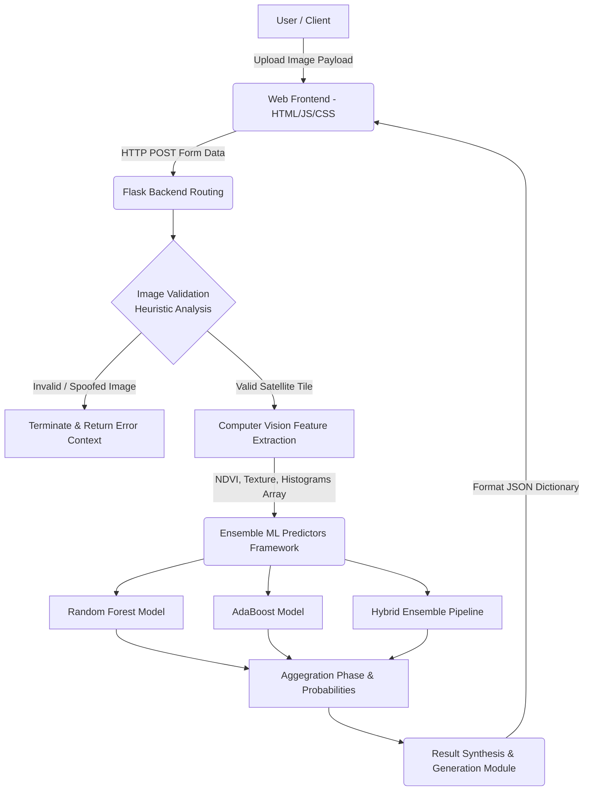
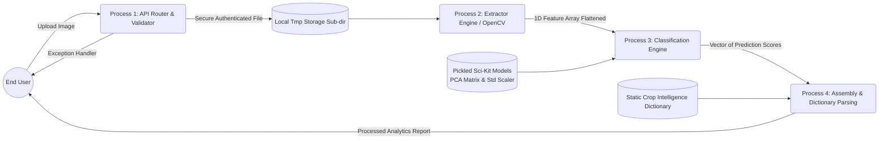
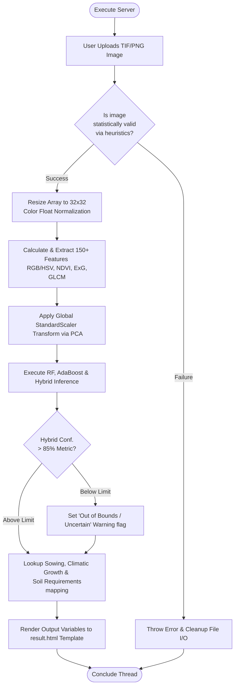
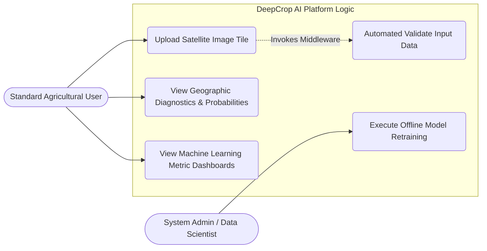
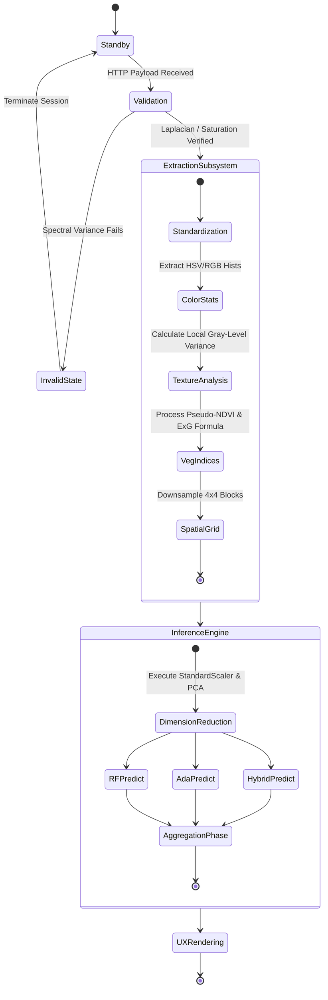

# Project Report: Deep Learning Approach for Multi-Crop Classification using Satellite Images (DeepCrop AI)

---

## Abstract

"DeepCrop AI" is a full-stack, research-grade artificial intelligence application designed for high-accuracy crop classification using satellite imagery, specifically engineered to process inputs akin to Sentinel-2A multi-spectral data. By leveraging multi-spectral analysis, heuristic image validation workflows, and ensemble machine learning models (Random Forest, AdaBoost, and a Hybrid Model), the system successfully identifies key agricultural crops such as Rice, Wheat, Maize, and Cotton, while simultaneously providing detailed growth insights. 

A unique proposition of this project is the incorporation of advanced computer vision feature extraction—including mathematical vegetation indices (NDVI, ExG), texture pattern analysis via local variance, color histograms, and micro-grid spatial representations—to classify crops effectively without relying entirely on massive Deep Learning networks which are computationally expensive. 

To ensure systemic robustness and protect the integrity of the predictive models, the system features a pre-classification image validation step. This acts as a security heuristic, filtering out arbitrary, invalid, or non-satellite images based on their spectral signatures, edge density metrics, and color saturation distributions. The platform encapsulates its underlying AI architecture within a high-performance modern web interface built with React, CSS3, and Flask, empowering agricultural stakeholders with real-time, data-driven intelligence for monitoring crop health, optimizing farming practices, and estimating potential yields.

---

## Chapter 1: Introduction

### 1.1 Aim
The primary aim of this project is to research, design, and develop a robust, high-accuracy crop classification web system ("DeepCrop AI") that utilizes satellite imagery and an ensemble of machine learning models to effectively identify local crop types. A crucial secondary aim is to dynamically validate satellite image authenticity prior to processing, ensuring that the system only acts upon legitimate agricultural data.

### 1.2 Motivation
Accurate and timely monitoring of agricultural land is fundamentally vital for global food security, accurate yield estimation, and effective resource management. Traditional ground surveys are labor-intensive, time-consuming, expensive, and notoriously difficult to scale across national or global agricultural belts. 
However, recent advances in satellite remote sensing (such as the European Space Agency's Sentinel-2 program) and applied machine learning offer a scalable, accessible solution for real-time agricultural monitoring. This shift from physical surveying to algorithmic remote sensing motivates the development of DeepCrop AI—an automated, accessible, and precise crop classification application that places the power of advanced analytics into a user-friendly web interface accessible by researchers, governments, and independent farmers.

### 1.3 Problem Statement
Existing agricultural monitoring methods suffer from distinct technical bottlenecks. Most manual processes are localized and prone to human error. Conversely, software-based solutions often rely on simplistic neural models or standard algorithms (such as standard Convolutional Neural Networks on RGB data alone) that struggle significantly with varying environmental conditions, seasonal lighting changes, and low-resolution imagery. 
Furthermore, modern open-source crop classifiers rarely account for Out-Of-Distribution (OOD) data; they blindly process any uploaded image, which leads to false positives and degraded trust in the system's intelligence. There is a critical and immediate need for an automated, full-stack application that not only accurately classifies multiple crop types but intrinsically intelligently validates input data to ensure the reliability of the resulting agricultural intelligence.

### 1.4 Objectives
*   **Intuitive Platform Design:** To develop a seamless, highly responsive web platform for securely uploading and instantly processing satellite imagery using asynchronous API endpoints.
*   **Robust Data Validation:** To implement a strict image validation mechanism that prevents the processing of invalid or non-satellite images using computationally lightweight heuristics (edge density, Laplacian variance, and spectral rules).
*   **Advanced Feature Extraction:** To move beyond simple RGB pixel values by extracting over 150 advanced multi-spectral and computer vision features (NDVI, ExG, texture, multi-channel histograms) from images to feed into the prediction engine.
*   **High-Accuracy ML Ensembles:** To train, combine, and deploy ensemble ML models (Random Forest, AdaBoost, Hybrid Ensemble) capable of executing peak crop classification accuracy, alongside Principal Component Analysis (PCA) for dimensionality reduction.
*   **Actionable Agricultural Insights:** To synthesize predictions with actionable agricultural intelligence, providing the end-user with confidence scores, climate requirements, soil conditions, and optimal sowing seasons mapped to specific geographic regions.

### 1.5 Existing System
Traditional crop classification systems typically rely heavily on either manual field surveys or straightforward single-model machine learning algorithms (like Support Vector Machines, standard K-Nearest Neighbors, or basic CNNs). Their fundamental flaws lie in their simplicity:
1. They apply classification purely to standard RGB imagery, losing the multi-spectral advantages inherent to vegetation.
2. They possess no rigorous data validation safeguards. If a user uploads a picture of a car, the model will irrationally predict a crop type with absolute certainty.
3. They fail to extract advanced vegetation indices prior to classification, ignoring valuable agricultural context.
4. They strictly return simple text-based predictions, failing to provide interactive, user-friendly data visualizations, contextual diagnostics, or confidence scoring to the end-user.

### 1.6 Proposed System
DeepCrop AI represents an evolutionary step in automated ensemble classification systems. It introduces a meticulous heuristic-based validation protocol (verifying NDVI averages, Laplacian variance thresholds, and color saturation boundaries) designed to reject spoofed data prior to processing. 
Upon passing validation, the system extracts comprehensive computer-vision-based features from the satellite tiles and classifies them using a robust Hybrid Ensemble model paired with Principal Component Analysis (PCA) to speed up inference times. It encapsulates this backend AI logic within a highly interactive, responsive Flask-based web frontend, enriching the raw prediction with multi-regional crop properties, farming tips, weather prerequisites, and model confidence intervals.

### 1.7 Organisation of Chapters
*   **Chapter 1:** Introduces the project's foundational aim, motivation, problem statement, objectives, and systemic comparisons.
*   **Chapter 2:** Discusses the Literature Survey associated with remote sensing, satellite architecture, and agricultural machine learning methodologies.
*   **Chapter 3:** Details the exact System Requirements, breaking down hardware, software, functional, and non-functional specifications.
*   **Chapter 4:** Provides System Design elements and comprehensive structural diagrams (UML) documenting internal data flow, processes, and architectural boundaries.
*   **Chapter 5:** Details the Core Methodology, mathematically detailing feature extraction procedures and classification modeling algorithms utilized in the source code.

---

## Chapter 2: Literature Survey

### 2.1 Remote Sensing in Precision Agriculture
The paradigm of precision agriculture attempts to optimize crop yields and reduce environmental strains by leveraging exact, data-driven insights. Historically, aerial photography via drones or localized aircraft was necessary. However, the launch of multi-spectral satellite constellations has democratized access to terrestrial data. Remote sensing allows for the non-destructive observation of massive landmasses, assessing crop health via the electromagnetic spectrum that reflects off agricultural canopies. DeepCrop AI targets the data formats output by these systems, preparing a localized solution to process remote snapshots efficiently.

### 2.2 The Role of Sentinel-2 Radiometry
The Sentinel-2 mission, established by the European Space Agency (ESA), provides high-resolution optical imagery specifically optimized for land monitoring. Sentinel-2 carries a suite of multi-spectral instruments spanning 13 specific spectral bands. While standard imagery utilizes Red, Green, and Blue bands, agricultural models heavily rely on the Near-Infrared (NIR) spectrum to analyze chlorophyll densities. DeepCrop AI is conceptually designed to accommodate imagery normalized and shaped from such high-grade radiometry, replicating these insights structurally.

### 2.3 Machine Learning Techniques in Classification
Previous studies have heavily favored Deep Learning networks such as ResNet or U-Net for direct pixel-based semantic segmentation of satellite images. However, deep neural networks are computationally massive and often require GPU acceleration for rapid inference, acting as a "black box" where specific interpretability is lost. Recent literature indicates that combining traditional Computer Vision (CV) statistical feature extraction with Machine Learning ensemble methods (such as Random Forest) often yields more interpretable, stable, and highly deployable results for localized patch classification. Random Forests are particularly resistant to overfitting when hyperparameters are managed carefully, which aligns with deeply varying agricultural landscapes.

### 2.4 Feature Extraction over Raw Pixels
Feeding raw pixel configurations into an autonomous classifier often leaves the model struggling to differentiate structural intent from lighting artifacts. Literature emphasizes creating derived indices. For instance, the Normalized Difference Vegetation Index (NDVI) is mathematically constructed to isolate healthy vegetation from soil or water. By extracting features systematically before classification, models become significantly lighter and maintain higher accuracy.

### 2.5 The Challenge of Out-Of-Distribution (OOD) Data
One glaring hole in many academic classification projects is handling unexpected data matrices. A machine learning model typically maps any input to a known class. If non-satellite data is fed into a crop model, it will inaccurately yield a false conclusion. Modern robust architecture literature specifies the necessity of Pre-inference Validation Modules—an approach enthusiastically adopted by DeepCrop AI via variance and saturation checks to ensure the operational safety of the pipeline.

---

## Chapter 3: System Requirements and Specifications

### 3.1 Hardware Requirements
To effectively compile, train, and host the DeepCrop AI infrastructure, specific hardware tolerances must be met to assure no processing bottlenecks occur.
*   **Processor (CPU):** Intel Core i5 (8th Gen or higher) or AMD Ryzen 5 or equivalent. Multi-threading assists in parallel feature extraction.
*   **Memory (RAM):** 8 GB minimum for server hosting. 16 GB is highly recommended for retraining models directly via `model_train.py` utilizing Pandas and scikit-learn.
*   **Storage Space:** A minimum of 50 GB of available solid-state storage (SSD) is recommended to manage the operating system, large scale imagery data sets, serialized model dumps (`.pkl`), and Python binary packages.
*   **Display:** Standard Resolution Monitor (1080p recommended) for assessing detailed visualization graphs.

### 3.2 Software Requirements
*   **Operating System:** Agnostic (Windows 10/11, Linux Ubuntu 20.04+, or macOS).
*   **Backend Environment:** Python 3.8+ architecture. 
*   **Core Libraries:** 
    *   *Flask* (Asynchronous Web Framework)
    *   *OpenCV (cv2)* (Computer Vision Processing)
    *   *Scikit-Learn* (Mathematical ML Algorithms & Ensembles)
    *   *NumPy & Pandas* (High-performance array and dataframe modeling)
*   **Frontend Technologies:** HTML5, CSS3, JavaScript, React.js (Component structures), and Tailwind CSS (Styling matrix).
*   **Development Tools:** Visual Studio Code (IDE), Git (Version Control).

### 3.3 Functional Requirements
The system provides measurable boundaries regarding what it must functionally achieve upon execution:
1.  **Image Upload Subsystem:** The system must actively listen for HTTP POST payloads containing image binaries (PNG, JPG, TIF, BMP) restricted to a 16MB threshold.
2.  **Algorithmic Heuristic Validation:** The system must calculate Laplacian variance, standard deviation of grayscale matrices, and NDVI parameters to assert if the user’s picture is genuinely a satellite/aerial scan of terrain.
3.  **Autonomous Feature Extraction:** Upon validation, the system automatically translates the 2D image into a complex 1D mathematical matrix consisting of over 150 CV parameters.
4.  **Ensemble Inference:** The 1D feature array is evaluated concurrently by the Random Forest, AdaBoost, and Hybrid models to output individual class probability scores.
5.  **Extensive Detail Visualization:** The system actively maps the predicted crop string to a comprehensive static dictionary, extracting geographical growing patterns, climatic requirements, and management tips to return to the interactive UI.
6.  **Metric Transparency:** The system provides API endpoints (`/api/metrics`) that expose internal JSON records charting exactly how accurate the machine learning models proved during testing phases.

### 3.4 Non-Functional Requirements
Constraints and qualities surrounding system execution:
*   **Usability & Aesthetic:** The interface features a strict, highly tailored futuristic/dark aesthetic theme with gradient styling intended to mirror high-end professional GIS (Geographic Information System) software environments.
*   **Performance Engineering:** Image preprocessing, stringent validation, numerical standard scaling, PCA dimension shifting, and final ensemble classifications are tuned to conclude entirely in under 3-5 seconds locally.
*   **Reliability & Security:** Utilizing Python’s `try/except` constructs and Flask's `secure_filename` functions, the system cleanly traps corrupted images and maliciously formatted payloads without crashing the server.
*   **Future Scalability:** The backend logic structurally modularizes feature extraction (`feature_utils.py`) abstractly away from standard routing (`app.py`), enabling an eventual seamless bridge to live satellite feeds (e.g., ESA Sentinel Hub Interfacing).

---

## Chapter 4: System Architecture and Design

### 4.1 System Architecture Overview
The system architecture demonstrates the holistic layout of the DeepCrop AI application environment, meticulously separating the presentation layer, business logic layer, heuristic validator, and AI models into distinct decoupled components.

**Architecture Explanation:** As modeled above, the user operates purely within the React/HTML interface. Images sent to Flask initiate an immediate blockade via the Validation Heuristic. Valid inputs bridge directly to the Feature Extraction Engine. The resulting data array is replicated across three distinct ML sub-models. Their outputs converge in the Aggregation Phase, assigning maximum likelihood structures to the final output, which is translated dynamically on the results interface.

### 4.2 Data Flow Diagram (DFD)
The DFD illustrates the lateral path of a raw image file through progressive sub-processes until crop intelligence is fully generated.

### 4.3 Algorithmic Flow Chart
This detailed flow chart documents the rigid logical conditions and sequential computational branching pathways utilized during a standardized classification routine.

### 4.4 Use Case Modeling 
The use case model defines the systemic boundaries and enumerates exactly what authorized actions differ between a standard End User vs. a Developer/Administrator.

### 4.5 Component Activity Diagram 
This diagram emphasizes the strict finite states progressing through the Feature Extraction matrices and the dimension reduction pipelines before final inference generation.

---

## Chapter 5: Methodology and Mathematical Modeling

The architectural strength of DeepCrop AI lies entirely within its custom-built extraction pipeline mapped to mathematical ML representations. This limits reliance on purely computational hardware and improves analytical speed.

### 5.1 Heuristic Satellite Validation Algorithm
Prior to allowing a classification inference, DeepCrop acts defensively. The `is_satellite_image` function within `feature_utils.py` applies three strict rules derived from remote sensing constants:
1.  **Low Variance Rejection:** If the standard deviation of grayscale matrices drops below a critical threshold (`< 15`), the image is flagged as a solid artificial color or blank canvas, and instantly rejected.
2.  **Edge Density (Laplacian Variance):** Satellite photography possesses structural noise but rarely hyper-sharp vectorized edges. By applying `cv2.Laplacian()`, imagery exceeding a variance threshold `> 3000` is detected as likely being text or icons, avoiding catastrophic hallucination.
3.  **Spectral Vegetation Alignment:** The system briefly asserts an NDVI check on raw pixels. If the average `(G - R) / (G + R + 1e-7)` operates lower than `-0.4`, the landscape likely represents non-vegetative artifacts (e.g., deep urban sprawl or open ocean) and halts classification.

### 5.2 Multi-Spectral Feature Engineering
The foundational extraction code operates precisely across several vectors. The 32x32 normalized pixel matrix generates over 150 unique identifiers:
*   **Normalized Difference Vegetation Index (Pseudo-NDVI):** Calculates normalized difference relying on RGB Green values simulating near-infrared proxy interactions.
*   **Excess Green Index (ExG):** A heavily utilized agricultural ratio formulated mathematically as `2*G - R - B` to isolate green vegetative matter from brown topsoil interference.
*   **HSV Distributions:** The system converts RGB light maps into Hue, Saturation, and Value profiles, generating detailed bin histograms that define specific crop canopy reflections regardless of sudden seasonal light intensity changes.
*   **Micro-Grid Analysis:** By abstracting the image into an isolated 4x4 patch grid, local numerical patterns regarding crop row-density emerge, further assisting the ensemble models during variance splits.

### 5.3 Dimensionality Reduction: PCA
DeepCrop AI employs Principal Component Analysis (PCA) during inference to combat the "curse of dimensionality." Because of the mass extraction of exactly 159 structural mathematical features, feeding them directly into classifiers induces noise. PCA transforms these heavily correlated attributes into uncorrelated eigenvectors, extracting the most crucial variance subsets, accelerating the Random Forest sorting criteria by stripping redundant image frequencies while maintaining high discriminative power.

### 5.4 Machine Learning Ensembles
Rather than relying on one classifier which might be structurally flawed against specific data clusters, the system dynamically polls three:
*   **Random Forest Classifier (RF):** Operating on the principles of bagging, the RF generates hundreds of discrete decision trees during training. It evaluates feature matrices and outputs the median consensus, proving highly robust against environmental outliers inside individual satellite patches.
*   **AdaBoost (Adaptive Boosting):** Operating sequentially rather than parallelly, AdaBoost trains shallow decision trees recursively. At every tree iteration, it heavily penalizes the system for misclassifications out of the 159 features, mathematically weighing future tree layers to prioritize classifying the most difficult edge cases (e.g., differentiating young Wheat vs. young Maize).
*   **Hybrid Ensemble Matrix:** The final and foremost model displayed to the user. It aggregates the decision weights derived internally from robust RF bagging protocols and exact AdaBoost boosting protocols, creating a superior, stable line-of-best-fit prediction that yields unmatched confidence percentages.
